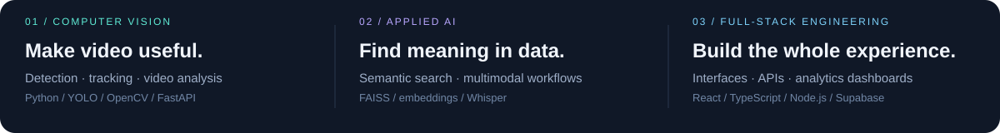

<!-- Profile content and visual assets are maintained in this repository. -->

  

  
  &nbsp;
  
  &nbsp;
  

### Hey, I'm Azeem 👋

I'm a software engineer based in **Pakistan**, working where **computer vision, applied AI, and web development** meet. I connect models and data pipelines to the APIs, dashboards, and interfaces that make them useful.

Right now, I'm extending a **basketball video-analysis pipeline** and integrating it with a scouting workflow. My portfolio also includes session replay, camera-monitoring dashboards, and a team-built multimodal search project.

  

## Selected work

<table>
<tr>
<td width="50%" valign="top">

<h3>🏀 Basketball Video Analysis</h3>

Connecting player and ball tracking to court views, event timelines, and structured scouting outputs.

<strong>My focus:</strong> pipeline extensions &amp; FastAPI integration. Ongoing work.

Python · YOLOv8 · ByteTrack · OpenCV · EasyOCR

<a href="https://portfolio-gamma-lake-28.vercel.app/"><strong>Watch the demo ↗</strong></a>

</td>
<td width="50%" valign="top">

<h3>▶ Session Replay &amp; Analytics</h3>

From browser event capture to replay: a full-stack workflow for exploring how people use a product.

<strong>My focus:</strong> React UI, event recording, backend ingestion &amp; API validation.

React · TypeScript · Node.js · Supabase · rrweb

<a href="https://github.com/AzeemAhmad123/UX-Analytical-Tool"><strong>Explore the code ↗</strong></a>

</td>
</tr>
<tr>
<td width="50%" valign="top">
<h3>✦ Lumina — Multimodal Search</h3>

A team final-year project for finding information inside documents, images, audio, and video using natural-language queries.

Python · FastAPI · FAISS · Sentence Transformers · Whisper

<a href="https://portfolio-gamma-lake-28.vercel.app/"><strong>Read the case study ↗</strong></a>
</td>
<td width="50%" valign="top">
<h3>🌸 FlowerShop</h3>

An eCommerce application connecting product browsing, shopping carts, customer accounts, and admin workflows.

C# · ASP.NET Core MVC · Entity Framework · SQL Server

<a href="https://github.com/AzeemAhmad123/FlowerShop"><strong>Explore the code ↗</strong></a>
</td>
</tr>
</table>

The basketball project extends the open-source work of <a href="https://github.com/HanaFEKI/AI_BasketBall_Analysis_v0">Hana FEKI / ENSTA Paris</a>. The portfolio explains the foundation, my contribution, and the current scope.

## My toolkit

  

  

**Beyond the icons:** YOLO · ByteTrack · Pandas · NumPy · FAISS · rrweb

<strong>A little more about how I work</strong>

 

- Start with the problem and the result someone needs.
- Connect the model or backend to a clear, usable interface.
- Be explicit about what works, what is experimental, and what comes next.
- Keep the handoff understandable with practical documentation.

You can also explore my [Python forecasting learning project](https://github.com/AzeemAhmad123/Machine-Learning-Projects) and the [source for my portfolio](https://github.com/AzeemAhmad123/Portfolio).

---

  <strong>Have a problem worth building for?</strong> 
  Computer vision prototypes · Analytics dashboards · Full-stack applications

  <a href="https://portfolio-gamma-lake-28.vercel.app/"><strong>See my work</strong></a>
  &nbsp; / &nbsp;
  <a href="https://www.fiverr.com/azeem_ahmadkhan"><strong>Let's talk about your project ↗</strong></a>

