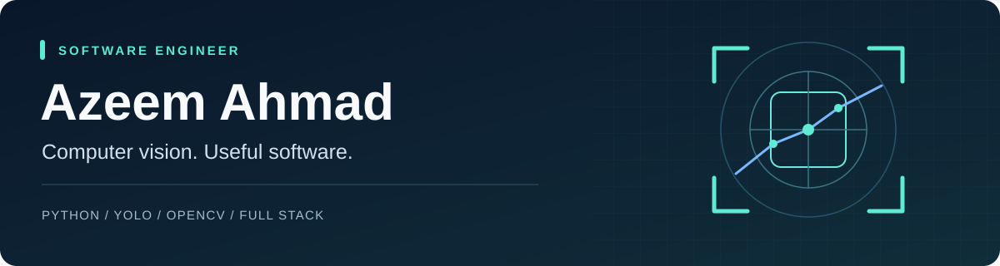

  

  <a href="https://portfolio-gamma-lake-28.vercel.app/"><strong>Explore my portfolio</strong></a>
  &nbsp; · &nbsp;
  <a href="https://www.fiverr.com/azeem_ahmadkhan"><strong>Work with me on Fiverr</strong></a>
  &nbsp; · &nbsp;
  <a href="https://github.com/AzeemAhmad123?tab=repositories"><strong>Browse my code</strong></a>

## Hi, I'm Azeem

I'm a software engineer based in Pakistan, building **computer vision tools and full-stack web applications**. My work connects Python and video-processing pipelines with APIs, dashboards, and interfaces people can use.

I enjoy turning a complex requirement into a practical workflow: understand the problem, build a focused solution, and make the result easy to review and maintain.

### What I work on

- **Computer vision:** object detection, tracking, video processing, and analysis workflows with Python, YOLO, OpenCV, and FastAPI.
- **Web applications:** React and Next.js interfaces, TypeScript, backend APIs, and database integration.
- **Data products:** session replay, analytics dashboards, and tools that make data easier to explore.

## Selected work

<table>
<tr>
<td width="50%" valign="top">
<h3><a href="https://github.com/AzeemAhmad123/UX-Analytical-Tool">Session Replay &amp; Analytics</a></h3>

A full-stack application for exploring user sessions, heatmaps, funnels, and interaction data.

React · TypeScript · Express · Supabase · rrweb

</td>
<td width="50%" valign="top">
<h3><a href="https://github.com/AzeemAhmad123/Portfolio">Project Portfolio</a></h3>

Case studies and video walkthroughs of my computer vision, analytics, and full-stack work.

HTML · CSS · JavaScript · Vercel

</td>
</tr>
<tr>
<td width="50%" valign="top">
<h3><a href="https://github.com/AzeemAhmad123/FlowerShop">FlowerShop</a></h3>

An eCommerce application with a storefront, shopping cart, customer accounts, and admin workflows.

C# · ASP.NET Core MVC · Entity Framework · SQL Server

</td>
<td width="50%" valign="top">
<h3><a href="https://github.com/AzeemAhmad123/Machine-Learning-Projects">Machine Learning Practice</a></h3>

A learning project exploring COVID-19 time-series data, visualization, and forecasting with Prophet.

Python · Pandas · Plotly · Prophet · Jupyter

</td>
</tr>
</table>

### Computer vision in practice

My portfolio includes an **ongoing basketball video-analysis project**, alongside camera-monitoring and review dashboards. On the basketball project, my work focuses on pipeline extensions and API integration, using YOLOv8, ByteTrack, OpenCV, EasyOCR, and FastAPI.

The basketball pipeline builds on an existing open-source foundation, **AI_BasketBall_Analysis_v1 by Hana FEKI / ENSTA Paris**. My portfolio explains my contribution and shows the current demo.

**[Watch the demos and explore the case studies →](https://portfolio-gamma-lake-28.vercel.app/)**

## Tools I work with

| Area | Technologies |
| --- | --- |
| Computer vision & data | Python, YOLO, OpenCV, Pandas, NumPy |
| Frontend | React, Next.js, TypeScript, JavaScript, Tailwind CSS |
| Backend & storage | FastAPI, Node.js, Express, SQL, Supabase, MongoDB |
| Development | Git, GitHub, REST APIs, Jupyter, Vercel |

## Let's build something useful

Have a computer vision prototype, analytics dashboard, or web app in mind? Share the problem you want to solve and the result you need. I value clear scope, realistic milestones, and a well-documented handoff.

**[View my work](https://portfolio-gamma-lake-28.vercel.app/)** · **[Discuss a project on Fiverr](https://www.fiverr.com/azeem_ahmadkhan)**
